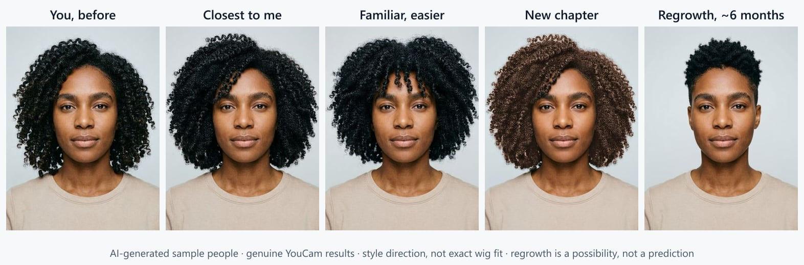
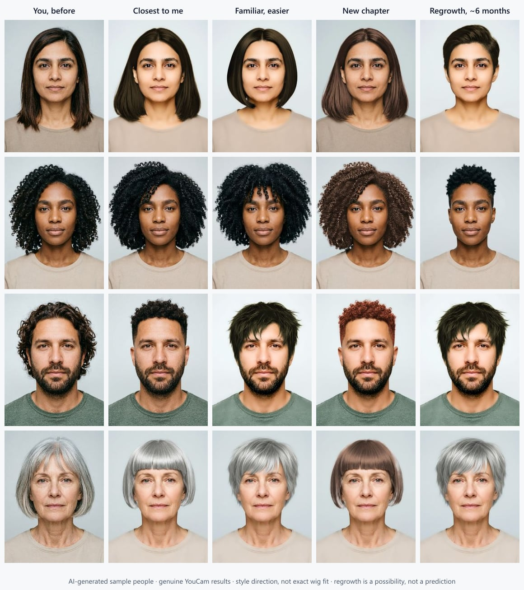
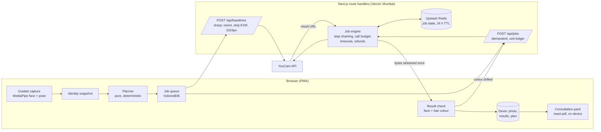

# Continuity Mirror

**Plan how you'll look through cancer treatment, before it starts.**

People facing chemotherapy-related hair loss are told to choose a wig *before* treatment and to bring a photo of their own hair. Most don't know what they want, and seeing options means a wig-shop visit at the most fragile moment. Continuity Mirror lets them try directions on their own face, privately, at home. They then take a one-page plan to the fitter.

**[Open the live app →](https://continuity-mirror.vercel.app)** · Demo video: _link added at submission_ · Built for the [YouCam API Skin AI & eCommerce VTO Hackathon](https://youcam-api-skin-ai-ecommerce.devpost.com/)



<sub>AI-generated sample person. Every image after the first is a genuine YouCam result. Style direction, not exact wig fit.</sub>

---

## Try it in 60 seconds (no photo needed)

1. Open **[continuity-mirror.vercel.app](https://continuity-mirror.vercel.app)** → **Try with a sample person**.
2. Pick a face (Meera, Amara, Daniel or Grace) → **I understand, continue** → **Looks right, see my three paths**.
3. Open a path. Drag the slider between *You, before* and the preview. Answer **Does this still feel like you?** and **Save to my plan**.
4. Open **My plan** → **Create consultation pack**. A real PDF is made on your device.
5. On any result, open **How this was made**: the real YouCam endpoints, parameters and task ids behind that image.

Sample results were made earlier with the live YouCam API and are labelled as such. To see it run live, choose **Use my photo** instead. A guided camera checks the photo first, and each path costs 2–3 YouCam units (capped at 24 per session).

## The insight

YouCam Hair Style rejects hair that is already too short (`error_hair_too_short`), and it needs shoulders in frame. **The tool only works while you still have your hair, and that is exactly when the decision has to be made.** The API's limit and the human window point to the same moment, so the product is built around it: capture *"me, before"* now, and plan from it.

## What it does

| | |
|---|---|
| **Guided capture** | On-device face and pose models check angle, shoulders, framing and light *before* anything is sent, so photos YouCam would reject never cost a unit. |
| **Identity snapshot** | The person says what makes their hair look like them (colour, length, parting, fringe, texture, brows). Nothing is guessed for real users. |
| **Three paths** | A deterministic planner picks *Closest to me*, *Familiar, easier* and *New chapter* from a curated catalogue of 51 styles. Coily hair is only ever shown coily styles. |
| **Compare and decide** | Every preview sits beside the original photo. The person answers "Does this still feel like you?" Nothing is scored. |
| **Result check and repair** | Each result is measured on the device: did the face stay the same, and is the hair still *their* colour? A drifted colour gets one automatic Hair Color repair. [Details below](#result-check-and-repair). |
| **Brow record** | The brows are cropped from the photo and kept on the device, matched to the closest of 17 YouCam brow shapes, as cancer charities advise doing before treatment. |
| **Regrowth roadmap** | Short styles at about 3, 6 and 12 months, previewed from the same photo. Labelled a possibility, not a prediction. |
| **My plan and consultation pack** | Saved looks become "what to ask for" in shop language, plus money help (the insurer term "cranial prosthesis", free wig programmes in the US, Canada, India and the UK, each with its source) and a pre-treatment checklist. Exported as a PDF made in the browser. |
| **Support circle** | An optional private link that expires, so family can vote on "which feels most like you". It never says why. |
| **Privacy centre** | A live receipt of what is on the device, what was sent to YouCam and what our server holds; one button deletes everything. |



## YouCam APIs used

| API | Endpoint | Units | Role |
|---|---|---:|---|
| File upload | `POST /s2s/v2.0/file` | 0 | Baseline upload (once per photo, reused by hash) |
| **Hair Style** v2.1 | `/s2s/v2.1/task/hair-transfer` | 2 | Every path. Template mode for 42 styles; custom reference mode with `hair_color: "src"` for coily, curly, locs and braids |
| **Hair Color** v2.0 | `/s2s/v2.0/task/hair-color` | 1 | Restores the person's own colour after a template (chained on the step-1 result URL), new-colour paths (full and ombre), and the automatic colour repair |
| **Hair Bang** v2.0 | `/s2s/v2.0/task/hair-bang` | 1 | "Try a fringe" variant (fitters often suggest a fringe when brows thin). Built into the job engine and checked live on four people; the button is not in the interface yet |
| **Makeup VTO** (eyebrows) v2.0 | `/s2s/v2.0/task/makeup-vto` | 1 | Brow preview from the 17 verified shapes |
| Credit | `GET /s2s/v1.0/client/credit` | 0 | Live balance for the unit circuit breaker |

The request bodies are pinned in [`lib/catalog/pipeline.ts`](lib/catalog/pipeline.ts) (the only place a YouCam body is built) and verified against the live API in [`docs/YOUCAM_FACTS.md`](docs/YOUCAM_FACTS.md). We tested Hat and Scarf VTO and left them out on purpose: they generate a whole new scene, which can't sit beside the person's own photo ([ADR 0005](docs/adr/0005-no-headwear-brow-record.md)).

## How a preview is made



- **The API key never reaches the browser.** Every YouCam call goes through server route handlers, and the CI build fails if a secret appears in the client bundle (`pnpm check:secrets`).
- **Idempotent jobs.** The job row is written on the device *before* the request; a reload re-sends the same `clientRequestId`, so a flaky connection never pays twice ([ADR 0002](docs/adr/0002-job-engine.md)).
- **A shared call budget.** A sliding window keeps us under YouCam's 200 calls per 300 s across all users. In a fake-clock load test, 25 people (75 jobs) all finish ([`tests/integration/load.test.ts`](tests/integration/load.test.ts)).
- **A unit ledger.** Every unit is reserved before a task, refunded if YouCam errors, and capped per session (24) and per IP per day (48). Below a floor, live generation pauses and sample mode stays available.
- **Results are copied to the device the moment they are ready**, so an expiring YouCam URL never breaks a saved plan.
- **Three adapters:** `live`, `mock` (stateless, watermarked, runs CI and previews with zero units) and `replay` (recorded, scrubbed fixtures) ([ADR 0007](docs/adr/0007-mock-and-replay-modes.md)).
- **Real-world numbers:** the sample set was built through this same stack in live mode: 42 jobs, 0 failures, and the units charged matched the estimate every time. A template path takes about 15–18 s, a reference path about 11 s.

## Result check and repair

Hair try-on should change the hair and nothing else. After each result is stored, the device measures the original and the result with MediaPipe (Face Landmarker + hair segmentation), and asks only two questions. It never rates anyone's face ([ADR 0008](docs/adr/0008-result-check-and-repair.md)).

1. **Did the face keep its geometry?** RMS movement of eyes, nose and mouth as a fraction of the eye distance.
2. **Is the hair still their colour?** CIEDE2000 between the original's and the result's hair, measured on a hair mask, only when the path promised to keep their colour.

If the colour drifted, the app makes **one** Hair Color pass and asks for the measured colour nudged away from the drift. It measures again and keeps whichever image is closer. Measured over every genuine sample result ([`docs/EVAL.md`](docs/EVAL.md), `pnpm eval`):

| | |
|---|---|
| Face geometry kept | **36 of 36** results (worst drift 0.010) |
| Different person in the same pose caught (negative control) | **4 of 4** (smallest drift 0.017; threshold 0.013) |
| Own-colour results that drifted and get a repair | **7 of 18** (39 %) |
| Live repair, end to end | ΔE **4.6 → 1.3**, face unchanged |
| Sample results repaired before shipping | **6** results (9 sample items share them), ΔE 3.5–7.0 → 0.8–3.0, one Hair Color pass each; the first version is one tap away |

The person sees one quiet line ("Your face is unchanged · Colour adjusted to match yours") and can open the first version. Numbers are never shown to them.

## Privacy

- Photos and results live in the browser (IndexedDB). Our server never stores a photo, except while a share link the person chose to create is live (private Blob, deleted on revoke or expiry).
- The consent screen states plainly that YouCam may keep processed files for up to 30 days and that we can't delete them.
- MediaPipe Tasks sends usage telemetry to Google with no off switch. We patched the dependency so it can't, and a unit test fails if an upgrade drops the patch ([`tests/unit/mediapipe-privacy.test.ts`](tests/unit/mediapipe-privacy.test.ts)). The production CSP also limits `connect-src` to our own origin.
- No account, no email, no analytics, and no scores of any kind.

## Honesty, enforced in CI

- **"Style direction, not exact wig fit"** is on every generated image. The build fails if a component renders a generated image without that label.
- A **claim guardrail** (`pnpm guardrail`) fails CI on medical or beauty claims ("diagnose", "cure", "guaranteed", "looks younger", "beauty score"…) and on tone we chose not to use ("fight", "battle", "brave").
- [`docs/FACTS.md`](docs/FACTS.md) maps every claim the interface makes to the code that keeps it true and the test that proves it.
- No bald simulation, no prediction of hair loss, no medical advice. Sample people are AI-generated and always labelled.

## Quality gates

| Gate | |
|---|---|
| Unit + integration (Vitest) | 324 tests in 30 files: planner (exhaustive sweep of 7,680 snapshot combinations + property tests), job engine, ledger, adapters, shares, result check, capture checks |
| End to end (Playwright) | Journeys with reload mid-generation, partial failure and retry, budget exhausted, rejected photo; capture with a fake camera; share round trip. Run on dev **and** on a production build |
| Accessibility | axe WCAG 2.2 AA on every route, light and dark, at 390 and 1280 px: 0 violations. Lighthouse (mobile, `/`): Accessibility 100, Best practices 100, SEO 100 |
| CI ([`ci.yml`](.github/workflows/ci.yml)) | audit → typecheck → lint → test → guardrail → API docs drift → build → secret scan |
| Performance budget | `/` first-load JS ≤ 180 KB gzip |

## Run it locally

Requires Node ≥ 22.12 and pnpm 10.

```bash
pnpm install
cp .env.example .env.local      # works as-is in mock mode: no API key, no units
pnpm dev                        # http://localhost:3000
```

| To… | Do |
|---|---|
| Use the real API | Set `YOUCAM_MODE=live`, `YOUCAM_API_BASE`, `YOUCAM_API_KEY` in `.env.local` |
| Run everything CI runs | `pnpm ci` |
| Run the browser tests | `pnpm test:e2e` (starts on :3100; real ML inference runs in the `capture` project) |
| Re-measure the result check | `pnpm dev`, then `pnpm eval` → `docs/EVAL.md` (spends no units) |
| Check a deployment | `pnpm smoke:live -- --url <url> [--route]` (1 unit, or 3 with `--route`) |

Deployment, environment variables and operations: [`docs/DEPLOY.md`](docs/DEPLOY.md), [`docs/RUNBOOK.md`](docs/RUNBOOK.md). HTTP API: [`docs/API.md`](docs/API.md) (generated from the Zod contracts).

## Repository map

```
app/(flow)/        consent → capture → snapshot → paths → compare, brows, regrowth
app/(app)/         plan, export, privacy, about, partners
app/api/           baselines, jobs, results, shares, status, privacy receipt, webhook, cron
lib/contracts/     Zod contracts shared by browser and server (+ OpenAPI)
lib/catalog/       51 curated styles, colours, brow shapes, pipeline.ts (spec → YouCam bodies)
lib/planner/       pure route planner
lib/server/        YouCam adapters, job engine, ledger, KV, sessions, rate limits, blob
lib/client/        Dexie store, job queue, capture engine, result check, PDF pack
docs/              ADRs, FACTS ledger, EVAL, YouCam facts, API, deploy, runbook
scripts/           guardrail, eval, demo builder, smoke test, contrast check
```

## Limitations

- A preview is a **style direction**, not a specific wig. Wig fibre, cap and fit are for a fitter.
- We have not yet tested it with people going through treatment, oncology nurses or wig fitters. The design rests on published evidence (sources in the app's About page). Validating it with them is the first next step.
- Hair Style needs enough hair and visible shoulders. Someone whose hair is already very short can still use the brows, money help and plan, but not style previews.
- The face check is a geometry check that catches a moved or swapped face. It is not identity verification.
- Money-help entries were checked on the date shown beside each one; programmes change.

## Credits

Built with the YouCam API by [Perfect Corp](https://www.perfectcorp.com/). Sample people are AI-generated ([`docs/ASSETS.md`](docs/ASSETS.md)). Third-party components and licences: [`docs/THIRD_PARTY.md`](docs/THIRD_PARTY.md). Code under the [MIT licence](LICENSE).
